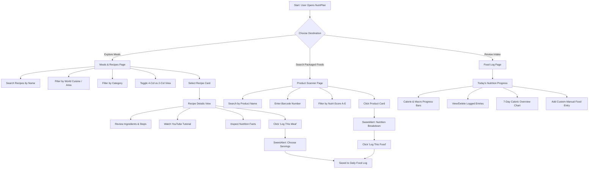

# NutriPlan — Food, Nutrition & Fitness Planner

NutriPlan is a modern Single Page Application (SPA) designed to help users discover culinary recipes, analyze packaged food products with Nutri-Score & NOVA classifications, and log daily nutrition intake with macro tracking.

---

## 📑 Table of Contents

- [Overview & Key Features](#-overview--key-features)
- [Project Architecture & Structure](#-project-architecture--structure)
- [How the Application Works (Technical Lifecycle)](#-how-the-application-works-technical-lifecycle)
- [Application Workflow & Engineering Workarounds](#-application-workflow--engineering-workarounds)
- [User Journey & Roadmap](#-user-journey--roadmap)
- [API Reference](#-api-reference)
- [Getting Started & Local Development](#-getting-started--local-development)

---

## 🌟 Overview & Key Features

- **Meals & Recipes Discovery**: Browse and filter dishes by world cuisine (Area) or food category. Live search by recipe name. Switch seamlessly between a 4-column compact grid and a 2-column detailed card view.
- **Detailed Recipe Breakdown**: Inspect ingredient measures with interactive checkboxes, step-by-step preparation steps, privacy-friendly YouTube video tutorials, and per-serving nutrition facts.
- **Packaged Product Scanner**: Search through packaged foods, browse product departments, or look up exact items via numeric barcodes. Filter results by Nutri-Score grade (A to E) and inspect NOVA food processing levels.
- **Daily Food Log & Macro Tracking**: Automatically calculate intake for Calories, Protein, Carbohydrates, and Fats against recommended daily targets. Log recipes with adjustable serving sizes, log products, or input custom foods.
- **Weekly Progress Timeline**: Visualize 7-day caloric consumption history with interactive daily summaries persisted in browser `localStorage`.
- **Responsive Layout**: Desktop navigation sidebar with mobile drawer overlay supporting swipe-away backdrop, button toggles, and `Escape` key dismissal.

---

## 🏗️ Project Architecture & Structure

NutriPlan follows Object-Oriented Programming (OOP) and Clean Architecture principles:

```text
Nutriplan - Design/
├── index.html                   # Single-page application entry shell
├── package.json                 # Project dependencies & build scripts
├── tsconfig.json                # TypeScript strict configuration (ES2022, bundler resolution)
├── README.md                    # Documentation & architecture guide
└── src/
    ├── css/
    │   ├── index.css            # Tailwind CSS compiled output
    │   └── style.css            # Custom layout overrides & responsive drawer styling
    ├── images/
    │   └── favicon.png          # App brand icon
    └── js/
        ├── main.ts              # Master application entry point
        ├── core/
        │   ├── api.ts           # MealDBApi service client
        │   └── router.ts        # AppRouter & client-side route manager
        ├── pages/
        │   ├── homePage.ts      # OOP controller: Meals & Recipes view
        │   ├── mealDetailsPage.ts# OOP controller: Recipe details & nutrition facts
        │   ├── foodLogPage.ts   # OOP controller: Food log & SweetAlert2 modals
        │   └── productsPage.ts  # OOP controller: Product scanner & barcode lookup
        ├── components/
        │   ├── ui.ts            # Shared UI renderers (spinners, empty states, meal cards)
        │   └── sidebar.ts       # Responsive sidebar drawer controller
        └── shared/
            ├── constants.ts     # Centralized app constants, URLs, and icons
            ├── types.ts         # TypeScript models, data contracts, and route types
            └── utils.ts         # Pure utility functions (escaping, formatting, date keys)
```

---

## ⚙️ How the Application Works (Technical Lifecycle)

### 1. Bootstrapping Phase (`main.ts`)
When `index.html` loads, it executes `src/js/main.js`:
1. **Service Instantiation**: An instance of `MealDBApi` is created.
2. **Layout Components**: `SidebarController` attaches responsive screen-width listeners and keyboard shortcuts (`Escape`).
3. **Page Controllers**: Instances of `HomePage`, `MealDetailsPage`, `FoodLogPage`, and `ProductsPage` are constructed with injected dependencies.
4. **Router Initialization**: `AppRouter` connects to the browser's `popstate` events, binds navigation links, registers the page controllers, and immediately invokes `router.init()`.

### 2. Client-Side Routing Flow (`core/router.ts`)
The router resolves the active route directly from `window.location.pathname`:
- `/` or empty path $\rightarrow$ Activates `homePage`
- `/meal/:id` $\rightarrow$ Activates `mealPage` with the target `mealId`
- `/foodlog` $\rightarrow$ Activates `foodLogPage`
- `/products` $\rightarrow$ Activates `productsPage`

Upon route change, `AppRouter`:
- Updates the document title, header heading (`#header h1`), and subtitle (`#header p`).
- Toggles CSS visibility classes (`.hidden`) on page container sections.
- Highlights active `.nav-link` anchors in the sidebar.
- Executes the designated controller method (e.g., `mealPage.render(mealId)` or `foodLogPage.render()`).

---

## 🛠️ Application Workflow & Engineering Workarounds

### 1. Client-Side SPA Routing Workaround
Because the application runs in vanilla TypeScript without a backend server to rewrite URLs:
- `router.navigate(page)` utilizes the HTML5 History API (`history.pushState`) to manipulate the address bar without triggering full page reloads.
- An `onNavigate` hook automatically dismisses the mobile navigation drawer when the user transitions between screens.
- Browser back/forward navigation is handled via the `popstate` window event listener.

### 2. Nutrition Analysis Pipeline
Meal recipes from the database only supply raw ingredient strings (e.g., `"1 cup Olive Oil"`). NutriPlan bridges this data gap:
- When viewing a recipe or logging it, `MealDBApi.getNutritionFacts` sends ingredient strings to the `/nutrition/analyze` endpoint authenticated with an API key.
- The server analyzes and returns normalized macro values (Calories, Protein, Carbohydrates, Fats, Fiber, Sugar).
- The calculated per-serving values are dynamically multiplied by the serving counter chosen by the user in the logging modal.

### 3. State Persistence & Storage Validation
The user's food log entries are persisted entirely inside `localStorage`:
- All stored records conform to the `FoodLogEntry` schema.
- At startup, `FoodLogPage` performs runtime integrity checks using a type guard (`isFoodLogEntry`) to sanitize corrupt or tampered storage entries.
- Logging actions recalculate daily intake sums on the fly and trigger immediate re-renders of the daily progress bars and the 7-day bar chart.

### 4. Interactive Modals via SweetAlert2
Instead of standard browser dialogs, NutriPlan uses SweetAlert2 for input validations:
- **Product Logging Modal**: Renders product brand, imagery, Nutri-Score badge, NOVA score, and an 8-panel nutrient table per 100g.
- **Recipe Logging Modal**: Prompts the user for serving count with positive whole-number validation (`min="1"`) before committing the scaled calories and macros to memory.

---

## 🗺️ User Journey & Roadmap



### Detailed Roadmap Steps:
1. **Recipe Discovery**: The user browses categories (Beef, Chicken, Seafood, Vegan...) or cuisines (Italian, Mexican, Japanese...).
2. **Recipe Inspection**: Clicking any card routes to `/meal/{id}` where ingredients can be marked off, videos watched, and macro compositions evaluated.
3. **Packaged Product Evaluation**: Switching to `/products` allows looking up supermarket products by name or barcode (e.g. scanning `"7613034626844"`). Nutri-Score filters highlight healthier options (Grade A/B).
4. **Nutrition Logging**: Dishes or groceries are added to today's log. Users can specify custom serving sizes or create manual foods through a guided prompt.
5. **Goal Tracking**: On `/foodlog`, progress bars reflect current intake versus standard daily targets (2000 kcal, 50g protein, 250g carbs, 65g fat).

---

## 📡 API Reference

Base API URL: `https://nutriplan-api.vercel.app/api`

| Endpoint | Method | Description |
|---|---|---|
| `/meals/areas` | `GET` | Fetches list of all available culinary regions |
| `/meals/categories` | `GET` | Fetches all meal category names and descriptions |
| `/meals/filter?category={name}` | `GET` | Returns paginated recipes belonging to a category |
| `/meals/filter?area={area}` | `GET` | Returns paginated recipes belonging to a cuisine area |
| `/meals/search?q={query}` | `GET` | Searches meals matching the query string |
| `/meals/{id}` | `GET` | Retrieves full recipe instructions, ingredients, and media |
| `/nutrition/analyze` | `POST` | Calculates estimated macro and calorie values from ingredients |
| `/products/categories` | `GET` | Lists available packaged product departments |
| `/products/category/{category}` | `GET` | Returns paginated items in a product category |
| `/products/search?q={query}` | `GET` | Searches packaged items by name or brand |
| `/products/barcode/{barcode}` | `GET` | Looks up detailed nutrition and metadata by exact barcode |

---

## 💻 Getting Started & Local Development

### Prerequisites
- Node.js (version 18+ recommended)
- A local HTTP server (e.g., Live Server, `npx serve`, or `python -m http.server`)

### Installation & Build
```sh
# 1. Install TypeScript development dependencies
npm install

# 2. Compile TypeScript files to JavaScript
npx tsc

# 3. Watch for changes during development
npm run typescript
```

### Running the App
Because the project uses native ES Modules (`import`/`export`), launch the workspace through a local server:
```sh
npx serve .
```
Then navigate to `http://localhost:3000` in your web browser.
